<p align="center">
  <picture>
    <source media="(prefers-color-scheme: dark)" srcset="docs/assets/hero-dark.svg">
    
  </picture>
</p>

# Migrate from Crayon: export your battlecards and competitive intel in one command

**How do I export my data from Crayon?** Crayon documents no bulk export of battlecards in its public materials (checked October 2026). The official way out is Crayon's MCP server. calven-migrate-from-crayon is a free, open-source command-line tool that signs in with your own Crayon account, asks Crayon a fixed set of questions about every competitor (battlecard, objection handling, proof points, win/loss stories, profile) and saves each answer verbatim, with Crayon's citations, as Markdown and JSON files on your own machine. It sends nothing to Calven. The files work in any tool that takes uploads.

> This is an independent open-source project by Calven AI, LLC. It is not affiliated with, endorsed by or sponsored by Crayon, Inc. Crayon is a trademark of Crayon, Inc., used here only to identify the service this tool works with. The tool runs on your machine, signs in with your own Crayon account through Crayon's official MCP server (and, if you choose, Crayon's Insights API with your own key), and writes files only to your computer. Nothing is sent to Calven. Use it in line with your agreement with Crayon: answers from Crayon's AI tools are Outputs you may use for internal business purposes, and material Crayon collected from third parties (for example news and reviews) is licensed to you, not owned by you. Provided under the MIT License, without warranty; check the export against your Crayon workspace before relying on it.

## How do I export my battlecards from Crayon?

You need Node.js 20 or later and a Crayon login. Run:

```sh
npx github:calven-ai/calven-migrate-from-crayon
```

1. A browser tab opens. Sign in to Crayon and approve read access (the `mcp:read` scope).
2. The tool reads the list of tools Crayon's server offers, finds your competitors, and asks five questions about each one.
3. It writes the files to `./crayon-export-<date>` and revokes the access it was given.

Each answer is generated on request, so 20 competitors means 100 questions; give it time. If something fails, nothing is sent anywhere; fix the cause and run it again with `--force`.

Know which competitors you want? Pass them and skip discovery:

```sh
npx github:calven-ai/calven-migrate-from-crayon --competitors "Acme, Globex, Initech"
```

Or put one name per line in a file and pass `--competitors-file competitors.txt`. No browser on the machine? Add `--no-browser` and open the printed link anywhere. Writing into a folder that holds an earlier export? Add `--force` to replace it. The tool only ever replaces a folder it exported to.

## Why is a Crayon export partial?

Crayon's MCP server, generally available since 4 September 2025, is a question and answer surface. It has no documented tool to list or extract battlecards. So this tool exports Crayon's answers, not the raw cards: whatever no question reaches is not in the export. `coverage.md` shows, for each competitor and question, whether Crayon answered, said it had nothing, or failed. Check the gaps in Crayon before you cancel.

The five default questions:

| id | asks for |
| --- | --- |
| `battlecard` | the full battlecard, every section and talking point |
| `objection-handling` | objections prospects raise and how to handle each |
| `proof-points` | customer proof points, case studies and quotes |
| `win-loss-stories` | win and loss stories: the deal, the outcome, the reasons |
| `profile` | overview, products, pricing, positioning, strengths, weaknesses, recent news |

Ask your own with `--questions-file questions.json`, a JSON array of `{"id": "pricing", "question": "What does {competitor} charge?"}`.

## Can I export Crayon insights and win/loss records too?

Crayon announced a read-only Insights API on 1 October 2026: insights with title, summary, date and tagged competitors, plus reviews, call clips and win/loss records (opportunity, amount, owner, competitor lost to). A Crayon admin creates the key. Crayon has not published the API's endpoint reference, so this tool does not guess it. The `--insights-key` path is built as an adapter: give it the list URL your Crayon admin or CSM provides, and it pages through every record by following the next link, cursor or page number the responses carry.

```sh
export CRAYON_INSIGHTS_KEY=...   # stays out of your shell history
npx github:calven-ai/calven-migrate-from-crayon --insights-url <url from Crayon>
```

Add `--skip-answers` to export only the Insights API. Without `--insights-url`, the tool stops and says the docs are pending. It has been tested against a simulated API only.

## What does the export contain?

```
crayon-export-2026-10-14/
  manifest.json      counts, tools used, coverage, origin counts, warnings
  coverage.md        which question got an answer for which competitor
  answers.json       every answer
  insights.json      every insight (only with the Insights API)
  markdown/
    index.md         table of contents by competitor
    answers/<competitor>/<question>.md
    insights/<type>/<insight>.md
  raw/               Crayon's response to every request, with the arguments sent
  tools.json         the tools Crayon's server offered
```

Each Markdown file starts with front matter (title, competitor, question, status, origin, date) followed by the answer exactly as Crayon returned it and a list of its citations. The JSON keeps the full response, and `raw/` keeps every reply untouched, so nothing the mapping misses is lost. Field definitions are in [docs/schema.md](docs/schema.md); the schema is the same neutral `calven-export/v1` used by [calven-migrate-from-klue](https://github.com/calven-ai/calven-migrate-from-klue).

## Is exporting allowed under Crayon's terms?

Crayon's terms (last updated June 2026) forbid developing "scripts designed to scrape or extract data from the Services". This tool does not scrape. It uses only Crayon's official MCP server and, if you choose, Crayon's official Insights API, with your own credentials, on your own machine. It never opens the Crayon web app, and Calven never holds your credentials. Whether your Crayon contract allows a given use is for you to check.

## Which content is yours to take?

Crayon's terms say the customer keeps ownership of its User Content and Inputs, and may use Outputs of Crayon's AI tools for internal business purposes. Material Crayon collected about competitors is third-party material Crayon licenses to you. The terms have no clause on returning data after termination, so export while you still have access. Every exported item carries an `origin`:

| origin | how it is set |
| --- | --- |
| `crayon_output` | every MCP answer: generated by Crayon's AI from your workspace |
| `customer` | an insight whose type is win/loss, deal or call clip |
| `crayon_or_third_party` | an insight whose type is review, news or web content |
| `unknown` | an insight of any other type |

It is a first pass, not a ruling. Check items before you reuse them outside your company, and delete third-party material when your Crayon contract ends.

## How do I migrate off Crayon to another tool?

The files are plain Markdown and JSON, so any tool that takes uploads can import them. Keep a copy outside both tools. The rest of a migration (notice dates, rebuilding the cards, moving the team) is covered in Calven's guide to [migrating off Klue or Crayon](https://calven.ai/resources/competitive-intelligence/how-to-migrate-off-klue-or-crayon?utm_source=github&utm_medium=oss&utm_campaign=migrate-from-crayon).

**Moving to Calven?** Upload the answers and the insights your team owns. Calven researches each competitor from scratch and works your material into its own. [Start at calven.ai](https://calven.ai/?utm_source=github&utm_medium=oss&utm_campaign=migrate-from-crayon).

## Can Claude run the export for me?

Yes. The [migrate-from-crayon skill](skills/migrate-from-crayon/SKILL.md) has Claude Code run this command. It runs the command rather than asking Crayon through a chat, so answers are saved verbatim and large workspaces do not hit context limits. If you then work with the files in an AI tool, use one that does not train on your inputs, such as Claude Team, Enterprise or the API.

## FAQ

**Is it free?** Yes. It is MIT-licensed and you need no Calven account.

**Does Calven see my data?** No. The tool talks only to Crayon and writes only to your computer.

**Does Crayon have an export button for battlecards?** Not one Crayon documents publicly as of October 2026. Crayon's official machine routes are its MCP server and its APIs.

**Can I get the raw battlecards instead of answers?** Crayon also has a Content API, which partners such as Glean use to read battlecards and their sections (Tiles). Its reference is not public and this tool does not call it. If your Crayon admin has the docs, that route returns the cards themselves.

**Does it export Sparks?** Not separately. Glean's Crayon connector documentation says Crayon's API returns only the last 30 days of Sparks, so save any you need from Crayon first.

**What if it stops with an error?**

| What you see | What to do |
| --- | --- |
| `Could not find a tool on the server that takes a question` | Run `npx github:calven-ai/calven-migrate-from-crayon inspect`, pick the tool in `crayon-tools.json`, and pass `--ask-tool <name>` (and `--question-arg <name>` if needed). |
| `needs arguments this tool does not fill in` | Find the argument in `crayon-tools.json` and pass it with `--arg name=value`. |
| `did not return a competitor list` | Pass the names with `--competitors` or `--competitors-file`. |
| many answers marked `no content` in `coverage.md` | Your Crayon role may see less. Ask a Crayon admin to run it. |
| sign-in fails | Your Crayon workspace may block third-party apps. Ask a Crayon admin. |

`inspect` writes tool names and argument schemas only, no Crayon content, so it is safe to attach to an issue.

## Status

Tested end to end against a simulated Crayon server across answer shapes, tool names, competitor discovery paths and Insights API paging styles. The sign-in metadata matches what Crayon's live servers publish (checked 14 October 2026). It has not yet been run on a real Crayon workspace, and Crayon has not published its MCP tool schemas, so tool and argument names are discovered at runtime. If you run it, an issue with your `manifest.json` (counts, no content) or `crayon-tools.json` helps.

## License

[MIT](LICENSE). Report security issues as described in [SECURITY.md](SECURITY.md).
